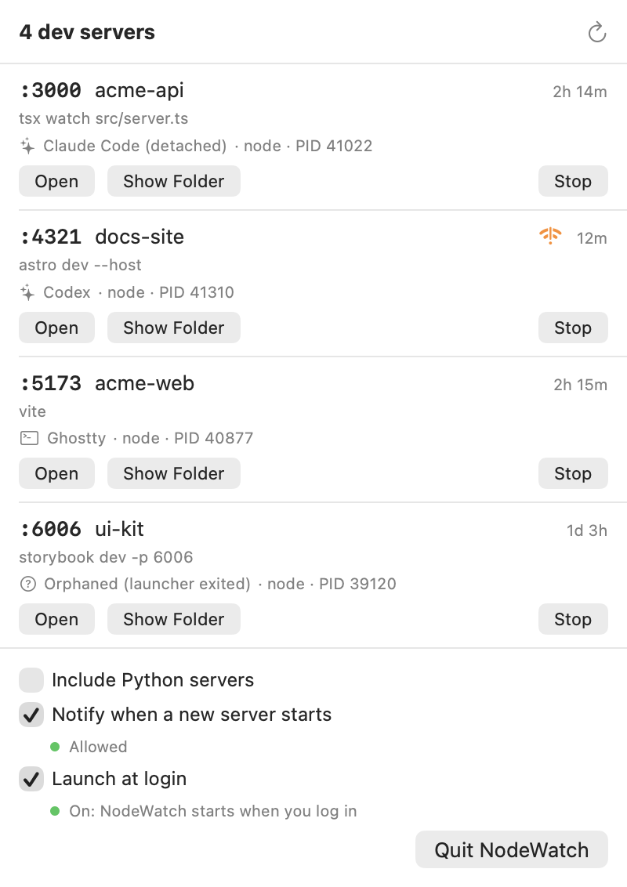

# NodeWatch

A small macOS menu bar app that shows which dev servers are running on your Mac, who started them, and whether other devices on your network can reach them. Open, reveal, or stop any of them in a click.



## Why

AI coding agents start dev servers all the time, often in the background, and rarely mention it. A few days later you have five `node` processes holding ports 3000 to 5174 and no idea which project they belong to or what started them. NodeWatch answers that from the menu bar.

## Features

- **Live count in the menu bar.** A server icon with the number of running dev servers, refreshed every 5 seconds.
- **One row per server:** port, project folder, the command that was run, uptime, runtime and PID.
- **Who started it.** Claude Code, Codex, Cursor, VS Code, a terminal (Terminal, iTerm2, Ghostty, Warp and others), or a background service. It still works after the agent or shell that started the server has exited (see [How it works](#how-it-works)).
- **Network exposure warning.** An orange icon marks any server bound to something other than `127.0.0.1` / `::1`, for example after `vite --host` or a bare `app.listen(port)`. Those servers can be reached from other devices on your Wi-Fi.
- **Actions:** Open in your browser, Show Folder in Finder, and Stop (click twice to confirm). Stop asks the server to shut down cleanly first and offers Force Stop if it ignores that.
- **Local (WordPress) sites, optional.** If you use [Local](https://localwp.com), NodeWatch can list its running sites, one row each with domain and PHP version, plus Local's shared router and Mailpit. See [Local sites](#local-sites).
- **Optional:** notifications when a new server starts, Python servers in the list, launch at login.

Runtimes covered: `node`, `bun` and `deno`, plus Python if you turn it on.

## Local sites

Turn on **Include Local (WordPress) sites** to add a Local section to the menu. Local runs every site as several processes (nginx, PHP-FPM and MySQL) plus a shared router and Mailpit, so NodeWatch groups them into one row per site instead.

- **Each site:** name, `.local` domain, PHP version and uptime, with **Open**, **Show Folder** and **Stop in Local**.
- **Shared services:** the router's ports and a **Mailpit** button, which opens the inbox that catches email your sites send.
- **Exposure:** Local's router listens on ports 80 and 443, and Mailpit on its web port, on every network interface by default. Both get the orange warning. Mailpit matters most: anyone on your network can read the emails your dev sites sent, password resets included.

There is no Stop button for Local sites on purpose. Local starts and stops its own sites. Stopping their processes from outside would leave Local showing them as running, and a forced stop risks corrupting a site's MySQL database. **Stop in Local** brings Local to the front instead.

NodeWatch reads Local's internal files (`~/Library/Application Support/Local/sites.json` and its `run/` folder). They aren't a public interface, so a Local update could change them. If that happens, the Local section disappears rather than showing wrong information. Tested with Local's nginx 1.26.1, MySQL 8.0.35, PHP 8.4.10 and Mailpit 1.24.1 services.

## Requirements

| | |
|---|---|
| macOS | 14 Sonoma or later (minimum deployment target) |
| Hardware | Apple silicon (the build script targets arm64; see [Intel Macs](#intel-macs)) |
| To build | Xcode, for `swiftc` and the macOS SDK. No Xcode project and no dependencies. |

### Tested on

- macOS 27.2 (build 26B123) on a MacBook Pro with an Apple M3 Pro
- Xcode 27.2, Swift 6.4.2, built in Swift 6 language mode
- Node.js 26.13.0 (Homebrew), plus Python launchd services

Earlier macOS versions back to 14 should work, since every API used is available there, but they have not been tested. Reports are welcome.

## Install

There is no prebuilt download. A download would need an Apple Developer ID signature and notarization, otherwise macOS blocks it on other Macs, so for now you build it yourself. It takes about a minute.

```bash
git clone https://github.com/joemendel/nodewatch.git
cd nodewatch
./build.sh
```

`build.sh` compiles the app, signs it for local use, copies it to `~/Applications/NodeWatch.app`, and launches it. Look for the server icon in your menu bar.

To update later, pull and run `./build.sh` again. It quits the running copy, replaces it, and relaunches. [CHANGELOG.md](CHANGELOG.md) lists what changed in each version.

To build without installing, run `./build.sh --no-install`. The app ends up in `build/NodeWatch.app`.

> **Keep the app out of iCloud Drive.** iCloud adds file attributes to anything it syncs, and those break the app's code signature, after which macOS refuses to launch it without saying why. `~/Applications` or `/Applications` are both fine.

## Uninstall

1. Open the NodeWatch menu and untick **Launch at login** (if you turned it on).
2. Click **Quit NodeWatch**.
3. Delete the app and its settings:

   ```bash
   rm -rf ~/Applications/NodeWatch.app
   defaults delete com.joemendel.nodewatch
   ```

If you allowed notifications, macOS keeps an entry under System Settings › Notifications until you remove it there. NodeWatch writes nothing else to disk.

## How it works

Every 5 seconds NodeWatch runs a few standard macOS commands, all read-only:

- `lsof` finds processes listening on TCP ports, the address each is bound to, and each one's working folder.
- `ps` reads the process tree, uptimes and command lines.
- `launchctl list` identifies background services (LaunchAgents).

**Finding the launcher.** NodeWatch walks up each server's parent processes until it reaches something it recognizes, such as Claude Code or a terminal app. When the agent or shell that started a server has exited, macOS reassigns the server to the system and that trail is gone. The server still carries the environment variables it was started with, though, and agents mark their child processes (Claude Code sets `CLAUDECODE=1`, for example). NodeWatch checks the environment for a short list of those marker names, once per server. Markers in a process's *arguments* are ignored, so a process can't fake its label that way.

**Stopping safely.** Process IDs get reused: after a server exits, macOS can give its ID to a new process. NodeWatch identifies each server by its process ID *and* its start time, and checks both right before sending any signal, so Stop never hits a different process.

## Privacy

- NodeWatch makes no network connections of its own. Open passes the server's URL to your browser, and that's all.
- No analytics, telemetry or logging.
- To identify launchers it reads other processes' environments, which in agent sessions can include API tokens. It only matches the marker names listed in `Sources/Scanner.swift`, never stores or displays anything else, and discards the text immediately.
- It can only see and stop processes that belong to your user account.
- With the Local option on, it reads Local's `sites.json`, which also stores each site's database credentials. NodeWatch copies out only the site name, domain, folder, PHP version and Mailpit port. The rest of the file is parsed along the way but never kept, logged or shown.

## Limitations

- **TCP listeners only.** UDP and Unix-socket servers aren't shown.
- **Stop targets the listening process.** If a supervisor such as nodemon, pm2, or a `KeepAlive` launchd job sits above it, the supervisor may start the server again.
- **"Exposed" describes the bind address, not your firewall.** A server on `*:3000` is flagged even if the macOS firewall blocks incoming connections to it.
- **Launcher detection is a best guess.** It recognizes the agents and terminals listed in `Sources/Scanner.swift`; anything else shows as a terminal, "Orphaned" or "Unknown".

## Troubleshooting

**The icon doesn't appear in the menu bar.** On MacBooks with a notch, macOS hides menu bar icons that don't fit beside it. Quit an app or two that has menu bar icons, or use a menu bar manager. Check that the app is running with `pgrep -lx NodeWatch`.

**Launch at login says "Needs your approval."** macOS registered the login item but wants you to confirm it. Click **Open Login Items** in the menu, which opens System Settings › General › Login Items, and switch NodeWatch on there.

**Notifications say "Blocked."** Click **Open Settings** in the menu and allow notifications for NodeWatch.

**A server is missing.** Only `node`, `bun` and `deno` are shown by default. Turn on **Include Python servers** for Python. Anything else (Ruby, Go, PHP and so on) isn't covered yet.

## Intel Macs

`build.sh` targets Apple silicon. To build for an Intel Mac, change `-target arm64-apple-macos14.0` to `-target x86_64-apple-macos14.0` in `build.sh`. This hasn't been tested.

## Project layout

| File | What it does |
|---|---|
| `Sources/Scanner.swift` | Finds servers and launchers using `lsof`, `ps` and `launchctl`. No UI code. |
| `Sources/LocalSites.swift` | Finds running Local sites and their shared router and Mailpit. |
| `Sources/ServerStore.swift` | App state, the 5-second polling, actions, notifications, launch at login. |
| `Sources/MenuView.swift` | The menu bar window. |
| `Sources/NodeWatchApp.swift` | App entry point. |
| `build.sh` | Build, sign, install and relaunch. |

Issues and pull requests are welcome. If your agent or terminal isn't recognized, the lists to extend are `agents`, `terminals` and `environmentMarkers` in `Sources/Scanner.swift`.

## License

MIT. See [LICENSE](LICENSE).
